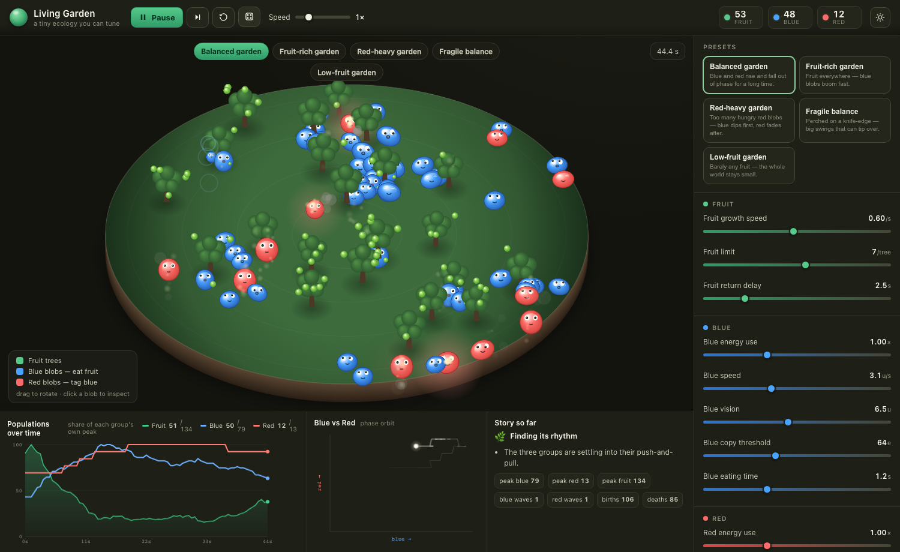

# 🌿 Living Garden

A cute little tabletop ecology you can tune. A round 3D-looking garden dish holds
**fruit trees**, **blue blobs** (they eat fruit) and **red blobs** (they gently tag
blue blobs for energy). Set the rules, press play, and watch the three groups rise
and fall in waves.

Open **`index.html`** in any modern browser — no build step, no dependencies, no
server. Just double-click it.



---

## The important part: the waves are real

Nothing about the charts is scripted. Every curve comes out of a per-blob **energy
budget** and a handful of local rules. The population waves *emerge*:

```
 fruit grows  →  blue blobs eat & breed  →  red blobs tag blue & breed
      ↑                                                   ↓
 fruit & blue recover  ←  red starve & fade  ←  many red thin the blue
```

Each blue and red blob carries **energy**:

- **Moving** costs energy (faster = more); **waiting** costs a little.
- **Blue blobs** restore energy by **eating fruit** (a short chew pause).
- **Red blobs** restore energy from a **gentle contact** with a blue blob, which
  drains that blue blob — then the red rests before it can tag again.
- **Making a copy costs stored energy**, so a group can't grow for free.
- **Fruit returns slowly** after it's eaten, so grazing pressure is real.

Left alone these rules want to swing to extinction (the classic predator–prey
problem), so three quiet **stabilisers** keep a garden coexisting for a long time:

1. **Hungry blobs are braver** — a starving blue tolerates a much closer red so it
   keeps feeding instead of panic-starving.
2. **Short red sight is a refuge** — when blue blobs get scarce, near-sighted reds
   genuinely can't find the survivors, giving blue room to recover.
3. **Predator territory** — reds packed together won't raise young, so a red boom
   can't overshoot and crash the blue group.

You can watch all three fight it out on the **Blue vs Red** phase orbit — a healthy
garden traces a loop instead of spiralling into a corner.

---

## Presets

| Preset | What you'll see |
|---|---|
| **Balanced garden** | Blue and red rise and fall out of phase for a long time. |
| **Fruit-rich garden** | Fruit everywhere — blue blobs boom fast. |
| **Red-heavy garden** | Too many hungry reds — blue dips first, red fades after. |
| **Fragile balance** | Big swings that grow until the garden tips over. |
| **Low-fruit garden** | Barely any fruit — the whole world stays small. |

## Controls

Transport: **play · pause · step · reset · randomize**, plus a **speed** dial
(0.25×–4×). Keyboard: `Space` play/pause, `→` step, `R` reset, `D` randomize,
`Esc` deselect.

Twenty sliders tune fruit growth / limit / return delay, each group's energy use,
speed, vision, copy threshold, eating & pause times, red contact strength, and the
world setup (trees, starting blobs, world size, seed). Sliders marked with a green
dot restart the garden; the rest tune it **live** while it runs.

Same **seed** + same settings replays the exact same garden — all randomness runs
through one seeded generator.

## Poke at it

- **Drag** the dish to rotate it; **scroll** to zoom.
- **Click a blob** to inspect its energy, age, current action, speed, sensing
  range, the time left in any eat/rest pause, its inherited traits, and its family
  (blobs pass speed / vision / strength to their children with small mutations, so
  traits can drift over generations — the story panel calls it out).

---

## Under the hood

- `js/sim.js` — the pure simulation (no DOM). Runs in the browser **and** Node, so
  the dynamics are testable headless. A spatial hash keeps neighbour lookups cheap;
  a fixed timestep keeps runs reproducible.
- `js/render3d.js` — the faux-3D dish, drawn with Canvas 2D. The round world is
  squashed into a tilted ellipse and objects are painted back-to-front with soft
  shadows, hops, blinks, leans, faces and little particle pops.
- `js/charts.js` — the timeline (three series indexed to one 0–100% axis — the
  honest way to overlay different units), the phase orbit, and the plain-language
  story.
- `js/app.js` — controls, presets, the render loop and all interaction.

### Verify the emergence yourself

```bash
node test/sim-test.js all 800     # run every preset headless, print sparklines
```

It prints population sparklines and a verdict for each preset, so you can confirm
the waves are coming from the rules, not from the pen.
